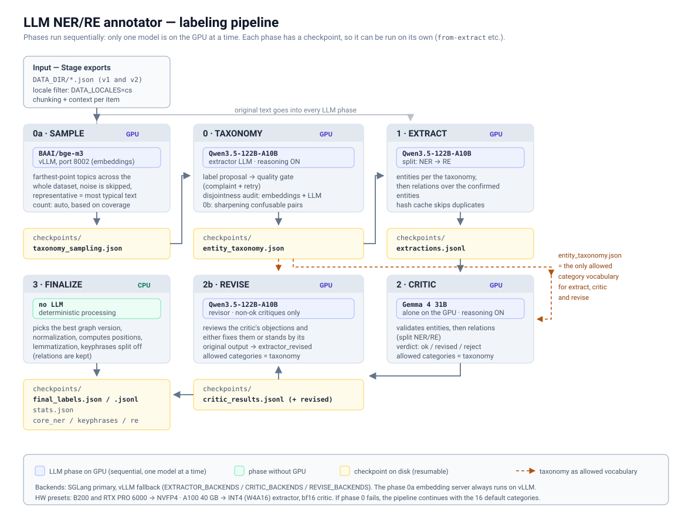

# Mudrc Labeler

Automated labeling of Czech texts with a pair of LLMs (extractor + critic).
The output is in the **Mudrc SKG** format (entities + relations + triples) —
ready to use as training data for a deterministic Stanza/spaCy pipeline.

## Key features

- **Universal taxonomy + discovery (default auto):** phase 0 (`taxonomy`) runs **in auto mode by default, in production too** — the LLM analyzes samples from all datasets and proposes a single unified taxonomy (samples are picked with bge-m3 embeddings in phase 0a; `TAXONOMY_SAMPLES_PER_DATASET` = `auto` or a number). It is **best-effort**: when auto fails (extractor unavailable, empty data, context overflow…), it falls back to the default 16 categories and the run CONTINUES — it never brings the pipeline down. Alternatives: `--taxonomy-mode user` (user-supplied `entity_taxonomy.json`) or `--taxonomy-mode off` (16 categories, no LLM call). It guarantees consistency — the same concept gets the same label across domains; the mandatory labels (PRODUKT/ORGANIZACE/DATUM/MISTO/HODNOTA) are added by the code itself.
- **Normalization layer for the silver dataset:** runs **automatically in every run** (production + smoke test). Offset fixes, auto-expansion of all mentions of an entity, label remapping (16 → 11), overlap removal, conflict resolution, removal of structural identifiers (URL/email/phone regex). Output: `final_labels.{jsonl,json}` + `normalization_report.json`. To turn it off (debugging) use `--no-normalize`.
- **Two separate datasets:** real descriptions vs. synthetically assembled texts → each has its own `final_labels*.{json,jsonl}` so the quality does not get mixed
- **Cross-family validation:** extractor Qwen3.5 (Alibaba, MoE) + critic Gemma 4 (Google, dense) = different tokenizers, different training data = genuinely independent validation
- **Phase 0 + 4 phases run sequentially, always 1 model on the GPU:** taxonomy (default auto) → extract (Qwen) → critic (Gemma) → revise (Qwen revisor) → finalize. Never two models at once, neither in production nor in the smoke test — the whole VRAM is reserved for one model at a time.
- **Split NER/RE (default ON, `SPLIT_NER_RE`):** extract, critic and revise each run as **two separate LLM calls** — one for entities (NER), the other for relations (RE, with the finished entities as context) — instead of a single call over the whole graph. The model focuses on one task → better quality and fewer malformed relations. Triples are derived from the relations deterministically (no extra call). Cost: ~2× LLM calls per phase. For the original behavior (everything in one call) set `SPLIT_NER_RE=false`.
- **Automatic Gemma → Qwen revisor loop:** the critique (status `revised` / `reject`) is stored in `critic_results.jsonl`, and phase 2b goes through it — it sends it to the revisor (by default the same model that labeled the description — Qwen3.5). The revisor decides on its own whether to apply the critique or stand by its output. Configurable via `REVISOR_*` env variables (see below).
- **Positions are computed by the application, not the LLM:** the LLM returns only the surface form ("text") and the lemma; `start_char`/`end_char` are computed in code over the original text, so indexes cannot be hallucinated. The invariant `text[start:end] == entity.text` + word boundaries + no overlaps is guaranteed.
- **Resume-safe:** every JSON record is fsync'ed, a crash = loss of at most 1 item; revise is idempotent
- **Hash deduplication:** identical texts are labeled only once
- **Self-repair:** invalid JSON from the extractor → retry with the error message
- **Reasoning mode:** the critic has thinking ON by default for quality, extractor + revisor have it OFF for speed
- **Chunking:** long texts (>12000 characters, `CHUNK_MAX_CHARS`) are split into sentences; in the finalize phase the chunks of the same document are joined back and entities are remapped onto the merged text
- **Windows + Linux:** PowerShell + bash scripts, `.gitattributes` fixes line endings
- **Smoke test profile:** mini models (Qwen3-0.6B + Gemma-3-1b) on an RTX 4070 (12 GB) or similar — shares the same 4-phase design as production
- **Production smoke test:** `scripts/run_smoke_test.{sh,ps1}` pushes 100 items per dataset through the whole pipeline on the target B200 hardware — a check of models, backends and the output format before the full production run.
- **OWL ontology export (smoke test only):** smoke-test `--phase finalize` generates a full OWL 2 ontology — `.owl` (RDF/XML) + `.ttl` (Turtle) + optionally `.html` (via `pylode`). Built with `rdflib` (no hand-written serializers). It contains the TBox (Document/Entity classes + per-label subclasses + per-relation ObjectProperties) and the ABox (Document and Entity individuals + the relations between them). Combined + per-source split.

## Taxonomy (universal across domains)

**Entity categories** (16 general classes, Czech UPPERCASE names — they match the Mudrc C# enum):

| Category | Description | E-shop example | Insurance example |
|---|---|---|---|
| `PRODUKT` | specific named product/service | Alpine Summit, ACME Basic | Pojištění auta OMEGA |
| `KATEGORIE` | product type in general | outdoor jacket, headphones | compulsory liability insurance, life insurance |
| `KOMPONENTA` | part of a product, sub-component | membrane, inverter, seam | deductible clause |
| `PARAMETR` | measurable property | water column, breathability | coverage limit, deductible |
| `HODNOTA` | specific value of a parameter | 20 000 mm, 40 mm, YKK | 100 000 Kč, 12 months |
| `MATERIAL` | raw material | memory foam, metal | (rarely) |
| `VLASTNOST` | design/style/feature | ergonomic cut | worldwide validity |
| `BENEFIT` | benefit for the user | thermoregulation, comfort | protection, peace of mind for the family |
| `POUZITI` | context / scenario / risk | mountains, city, office | injury, theft, fire |
| `TECHNOLOGIE` | technology/method | ANC, GORE-TEX | online signup |
| `SPECIFIKACE` | technical standard | Bluetooth 5.3, USB-C | ISO 9001 |
| `ORGANIZACE` | company, institution | ACME, Apple | ACME Pojišťovna |
| `OSOBA` | specific person | (rarely) | (rarely) |
| `MISTO` | geographic place | (rarely) | Praha, ČR |
| `DATUM` | date, time interval | (rarely) | 1.1.2026, 12 months |
| `SUBJEKT` | generic fallback | — | — |

**Key principle:** insurance terms are NOT mapped to specific categories such as `INSURANCE_PRODUCT` or `DEDUCTIBLE` — they are mapped to the general ones instead (`PRODUKT`, `PARAMETR`). The LLM gets examples from both domains in the prompt so it understands the mapping principle.

**Relations:** 37 types, English names in `snake_case` (`is_a`, `has_component`, `has_value`, `provides_benefit`, `covers`, `suitable_for`, ...). See `labeler/schemas.py` for the full list.

## Taxonomy Discovery (phase 0 — default auto)

The pipeline has a **phase 0** (`python -m labeler.main taxonomy`, or automatically
before `extract`/`pipeline`) that determines which labels the LLM will use in the
extract phase. **The default is `auto` and it runs in production too** (not only in the smoke test):

| Mode | What it does |
|---|---|
| `auto` (default) | The LLM (Qwen3.5) goes through **samples from all datasets in `DATA_DIR`** and proposes a **unified taxonomy** covering all domains. It guarantees consistency: the same concept = the same label, no duplicates across domains. Quality gate + 1 retry. **Best-effort**: when auto fails (extractor unavailable, empty data, context overflow…) OR the LLM does not deliver a good taxonomy even after the complaint → it falls back to the default 16 categories and the run CONTINUES. Samples are picked by phase 0a embeddings (`TAXONOMY_SAMPLES_PER_DATASET` = `auto` or a number, see [Sample selection](#sample-selection-for-the-taxonomy-phase-0a--bge-m3-embeddings-on-vllm)). |
| `off` | No discovery, no LLM call. The default 16 categories from `EntityCategory` are used (`PRODUKT`, `KATEGORIE`, `POUZITI`, …). |
| `user` | The user provides an `entity_taxonomy.json` (see [examples/entity_taxonomy.example.json](examples/entity_taxonomy.example.json)). The pipeline validates it and uses it. |

Output (except for `off`): `checkpoints/entity_taxonomy.json`. The `extract` phase
loads it automatically (if it exists) and inserts it into the system prompt instead of the default.

### Usage

```bash
# Default — extract runs phase 0 in auto mode by itself (best-effort discovery)
python -m labeler.main extract

# Turn discovery off (the 16 original categories, no extra LLM call)
python -m labeler.main extract --taxonomy-mode off

# Run phase 0 separately in advance (optional — extract runs it on its own otherwise)
python -m labeler.main taxonomy --mode auto --samples-per-dataset 15
python -m labeler.main extract       # uses the existing entity_taxonomy.json

# User mode (user-supplied JSON)
python -m labeler.main taxonomy --mode user \
    --user-taxonomy examples/entity_taxonomy.example.json
python -m labeler.main extract

# Pipeline integration (a single command) — auto is the default, off/user also work
python -m labeler.main pipeline --taxonomy-mode auto --samples-per-dataset 10
```

### `entity_taxonomy.json` format

```json
{
  "version": 1,
  "mode": "auto",
  "generated_at": "2026-05-14T10:00:00+00:00",
  "source_datasets": ["pojistovna-demo", "eshop-demo", "sperky-demo", "kosmetika-demo"],
  "labels": [
    {
      "code": "PRODUKT",
      "description": "Konkrétní pojmenovaný produkt nebo služba.",
      "examples": ["ACME Basic", "Pojištění auta OMEGA", "iPhone 15"],
      "domains": ["e-shop", "pojišťovnictví"],
      "aliases": ["PRODUCT", "ITEM"]
    },
    {
      "code": "ORGANIZACE",
      "description": "Firma, instituce, značka, výrobce.",
      "examples": ["ACME Pojišťovna", "ACME", "DEMO šperky"],
      "domains": ["e-shop", "pojišťovnictví"]
    }
  ]
}
```

Complete example: [examples/entity_taxonomy.example.json](examples/entity_taxonomy.example.json) — labels covering e-shop, insurance and cosmetics.

> **Note.** URL, EMAIL and TELEFON do not belong in the NER taxonomy — they are regex-detectable structures, not named entities. If the LLM extracts them anyway, `_step_drop_structural_identifiers` in normalize drops them (counter `structural_identifiers_dropped`). If downstream code needs them, it runs URL_RE / EMAIL_RE / PHONE_RE directly on input_text — deterministic, no model needed.

### Validation rules (auto + user)

- `code` must be **UPPERCASE_SNAKE** (`^[A-Z][A-Z0-9_]{0,49}$`)
- `description` ≥ 10 characters
- at least 2 labels
- no duplicate `code` (deduplication via `aliases`)
- the LLM gets an explicit rule: **PRODUKT vs ITEM = duplicates, return only PRODUKT**

### Quality gate + mandatory labels (auto only)

After parsing + deduplication, auto mode additionally:

- **Adds mandatory labels** — if the LLM did not propose one of `PRODUKT`,
  `ORGANIZACE`, `DATUM`, `MISTO`, `HODNOTA`, **the code adds it itself** (the check
  is case-insensitive against codes and aliases, so nothing is added twice). The pipeline
  relies on these universal categories → it does not count on the model "hitting" them.
- **Quality gate** — the proposal must contain at least **5 labels from the LLM itself**
  (mandatory labels added by the code do not count) and pass the validation above. If
  it does not pass, the LLM is sent a **specific complaint** (what is wrong) and gets a
  **second attempt**. If that fails too, a `TaxonomyQualityError` is raised →
  `run_taxonomy_discovery` catches it, **does not save** `entity_taxonomy.json` and the
  pipeline **falls back to the default 16 categories** (like `mode=off`). The run does not crash.

### Optional data-driven heuristics (per label)

Every `TaxonomyLabel` may contain 3 optional fields that steer normalization **without hard-coding anything in the code**:

| Field | Purpose | Example (insurance dataset) |
|---|---|---|
| `force_text_match` | Texts that ALWAYS end up under this label, even if the LLM chose another one | `PRODUKT.force_text_match = ["ALFA", "BETA", "GAMA"]` |
| `unsafe_texts` | Texts that must NEVER end up in this label (downgraded to KEYPHRASE_SUBJECT) | `PRODUKT.unsafe_texts = ["pojištění", "auto", "smlouva"]` |
| `case_sensitive` | Case sensitivity for both lists (default false) | `true` for proper names (ALFA), `false` for generic words |

If the taxonomy does not contain these fields, `_step_apply_taxonomy_text_rules` is skipped — no hard-coded heuristics are used. The pipeline is **100% universal**: there are no domain-specific terms encoded in the Python code.

For **new datasets** (any domain, even one that was never about insurance) you simply create an `entity_taxonomy.json` (auto or user mode) and fill in `force_text_match` / `unsafe_texts` as needed — the code does not change.

### Auto mode — how consistency works

The LLM gets one big prompt:
- a bullet list of all detected **domains** (from `dataset.name`)
- samples from each domain **spread across the whole dataset** — not just the first N.
  It takes 3 "anchors" (first / middle / last item) + `--samples-per-dataset`
  random ones from the rest (deterministic via a seed), so the result is up to `N+3`
  samples covering the beginning, the middle and the end of the dataset. Default `N=10`.
- rules: the same concept = the same label, no duplicates (PRODUKT vs ITEM)
- mandatory labels: PRODUKT, ORGANIZACE, DATUM, MISTO, HODNOTA (URL / EMAIL / TELEFON do not belong here — regex-detectable structures, see above)

It returns a single consolidated JSON. The application then post-processes it: `_deduplicate_aliases`
(merges 2 labels with the same code/alias) → adds the missing **mandatory labels**
→ runs it through the **quality gate** (min. 5 labels from the LLM + validation). If the
quality is insufficient, one retry with a complaint, then a fallback to the default 16
categories (see [Quality gate + mandatory labels](#quality-gate--mandatory-labels-auto-only) above).

## Sample selection for the taxonomy (phase 0a — bge-m3 embeddings on vLLM)

Instead of a random selection, the LLM in phase 0 gets samples that cover **the widest
possible range of topics** of each domain. The count is controlled by `TAXONOMY_SAMPLES_PER_DATASET`
(the scripts ask for it, Enter = the value from `.env`, default `auto`):

| value | behavior |
|---|---|
| `auto` *(default)* | each domain computes its own count: samples are added (always the text most different from those already picked) until **every** text of the domain has a representative in the sample with cosine similarity ≥ `TAXONOMY_SAMPLE_COVERAGE` (0.65); bounds `TAXONOMY_SAMPLE_MIN`–`MAX` (5–60) |
| a number, e.g. `30` | exactly that many samples per domain, picked to be as different as possible |

A monotonous domain thus gets a few samples, a diverse one dozens. The total across all
domains is capped by `TAXONOMY_SAMPLE_MAX_TOTAL` (200 ≈ 35k prompt tokens out of a 65k
context); when exceeded, the least distinct samples are dropped first.

**Which texts exactly** (`TAXONOMY_SAMPLE_SCOPE`, default `global`): the embeddings
do not only determine the count, they pick the samples directly — from the **whole dataset at once**
(`TAXONOMY_SAMPLE_POOL_MAX=0` = all texts are encoded):

1. texts are grouped by similarity into topics (across all domains),
2. topics are processed from the most distinct one, always taking the **most typical** text
   of the topic (not the strangest one),
3. isolated outliers (a topic with < `TAXONOMY_SAMPLE_MIN_CLUSTER` texts — links,
   codes, fragments) are never picked as samples,
4. the same content in several domains (an e-shop footer, "free shipping") is a single
   topic → it is picked once,
5. every domain gets at least `TAXONOMY_SAMPLE_MIN` samples.

`TAXONOMY_SAMPLE_SCOPE=domain` = selection per domain separately. Selection statistics
(number of topics, noise, coverage) are in `taxonomy_sampling.json` → `global`.

**How it runs:** a separate `sample` phase BEFORE phase 0 — only the
embedding server is on the GPU (the "1 model on the GPU" rule holds):

```text
sample   → embedder-vllm (BAAI/bge-m3, vLLM --runner pooling, port 8002)
           + labeler-embed-vllm → checkpoints/taxonomy_sampling.json
taxonomy → Qwen proposes the taxonomy from the selected samples
```

- `./scripts/run_production.sh all` and `run_smoke_test.sh` both run it
  automatically; on its own: `./scripts/run_production.sh sample`,
  CLI `python -m labeler.main taxonomy-sample`.
- **Best-effort:** when the step fails, does not run, or `taxonomy_sampling.json` was
  computed with different settings / on different data, phase 0 takes a random selection
  (10 + 3 anchors per domain) and the run continues. What was used is recorded in `notes`
  in `entity_taxonomy.json`.
- **Why vLLM:** the embedding server is the **only** part of the pipeline on vLLM
  (all LLM phases run on SGLang). vLLM has official support for bge-m3 —
  the model's `config.json` declares `XLMRobertaModel`, which is why it is started with
  `--runner pooling --hf-overrides '{"architectures": ["BgeM3EmbeddingModel"]}'
  --pooler-config.task embed` (per docs.vllm.ai → Pooling models). SGLang does not
  officially support bge-m3 and has open bugs for it.
- **Native runtime:** Linux — `run_*.sh` starts vLLM via
  `start_native_llm.sh` with `NATIVE_ENGINE=vllm`. vLLM is not installed
  automatically (in the same environment as SGLang the torch versions clash):
  `python -m venv ~/vllm-env && ~/vllm-env/bin/pip install vllm` and
  `export VLLM_BIN=~/vllm-env/bin/vllm`. Windows (`run_*.ps1 -Runtime native`)
  skips the phase — vLLM does not run on Windows (use Docker).

### Number of categories in phase 0

`TAXONOMY_MIN_LABELS` / `TAXONOMY_MAX_LABELS` control how many categories the model
should propose (default 8–16). **Both bounds can be turned off with the value `0`:**

| setting | what the prompt says |
|---|---|
| `MIN=8` `MAX=16` | "a reasonable count is 8–16 labels" (default) |
| `MAX=0` | "propose at least 8, there is no upper bound" |
| `MIN=0` | "propose at most 16, there is no lower bound" |
| both `0` | "the number of labels is not limited in any way" |

In all variants without a cap the prompt reminds the model that the labels must stay
distinguishable from each other — an unlimited list is exactly where overlapping
categories appear. `MIN=0` also turns off the quality gate that otherwise
sends a complaint about a small proposal and lets the model try again.

A structural condition remains even with `MIN=0`: the taxonomy must have at least 2 labels
(a single-label one has nothing to distinguish) and the parser rejects an empty proposal.

## Taxonomy Embedding Analysis (phase 0b — automatic)

**Embeddings are used in the taxonomy phase automatically — in the smoke test and in
production.** After every taxonomy creation (`taxonomy`, `extract`, `pipeline`,
`smoke-test --phase taxonomy`) the analysis below runs and the disjointness audit measures
how confusable the classes are with both embeddings and an LLM probe (`TAXONOMY_AUDIT_RULER=combined`). To turn it off:
`TAXONOMY_EMBEDDING_ENABLED=false` / `TAXONOMY_AUDIT_RULER=llm`.

**What it does:** for the classes in `entity_taxonomy.json` it builds sentence embeddings
from their text profiles (code, description, aliases, domains, examples), computes
the cosine similarity of all pairs, runs a deterministic agglomerative
clustering and classifies the pairs:

```text
possible_duplicate:
The classes are so similar that they may be duplicate definitions.

possible_overlap:
The classes may describe overlapping concepts.

disjoint_candidate:
The classes are far apart in the embedding space, but the result is not a logical proof.

uncertain:
The result is ambiguous and needs a manual check.
```

**What it does NOT do:** it is not a formal proof of OWL disjointness. Embedding
distance is a heuristic — two classes can be semantically distant and still
logically compatible (and vice versa). All outputs carry
`formal_disjointness_proof: false` and `confidence` is a heuristic score, not a
calibrated probability. This analysis does NOT REPLACE the deterministic alias deduplication
of the taxonomy — it only complements it with a semantic view.

**Running it (CLI):**

```bash
python -m labeler.main taxonomy-embeddings \
  --taxonomy checkpoints/entity_taxonomy.json \
  --output-dir checkpoints \
  --overlap-threshold 0.72 \
  --disjoint-threshold 0.30
```

The CLI parameters (`--model`, `--device`, `--batch-size`, `--threshold-mode`,
`--center/--no-center`, `--duplicate-z`, `--overlap-z`, `--disjoint-z`,
`--duplicate-threshold`, `--overlap-threshold`, `--disjoint-threshold`,
`--cluster-distance-threshold`, `--write-vectors/--no-write-vectors`,
`--seed`) take precedence over the env configuration (`TAXONOMY_*` in `.env`).
Invalid thresholds (it must hold that `disjoint < overlap <= duplicate`, or
`disjoint_z < overlap_z <= duplicate_z`) make the command fail BEFORE the model is loaded.

### Anisotropy and why the embeddings are centered

Sentence embeddings are **anisotropic** — all vectors lie in a narrow cone
with a strong common component (for taxonomy profiles it is further amplified by the shared
`Kód:/Popis:/Příklady:` boilerplate). Consequence: *everything* looks similar to
everything. Measured on an 11-class taxonomy (multilingual MiniLM):

| variant | similarity range | most distant pair |
|---|---|---|
| without centering | 0.42 – 0.85 (spread **0.43**) | DOKUMENT × OSOBA +0.42 |
| **with centering** | −0.45 – +0.50 (spread **0.95**) | MATERIAL × OSOBA **−0.45** |

Subtracting the mean vector (`TAXONOMY_EMBEDDING_CENTER=true`, default) doubles the spread
and above all **gives the sign a meaning**: a positive similarity = the pair is
more similar than the average pair, a negative one = more distant. After centering the
semantics fit as well — the most distant pairs are the ones that really are disjoint.
Centering is skipped automatically for < 3 classes (degenerate).

**Interpreting similarity and the z-score:** because the absolute cosine range differs
from model to model, the classification by default does not rely on absolute numbers but on a
**robust z-score** over the similarity distribution of the given taxonomy:

```text
z = (similarity − median) / (1.4826 × MAD)
```

`z = 0` is a typical pair, `z > 0` more similar than average, `z < 0` more distant.
The thresholds (`TAXONOMY_DUPLICATE_Z=2.5`, `TAXONOMY_OVERLAP_Z=1.0`,
`TAXONOMY_DISJOINT_Z=-0.5`) therefore mean "an outlier within **this**
taxonomy", which transfers across models and languages. The report lists the
distribution (median, MAD, spread) and the z-score of every pair, so you can see
what the classification is based on. A narrow spread = the model does not distinguish the classes (consider another
model), a wide one = well-separated classes.

If you want fixed thresholds calibrated for a specific model, switch to
`TAXONOMY_THRESHOLD_MODE=absolute` (then
`TAXONOMY_DUPLICATE/OVERLAP/DISJOINT_SIMILARITY_THRESHOLD` = 0.90/0.72/0.30 apply).

**Reports** (checkpoint dir, atomic writes): `taxonomy_embedding_report.json`
(machine-readable, Pydantic schema), `taxonomy_embedding_report.md` (human-readable:
clusters, duplicates, overlaps, disjoint candidates, uncertain pairs, recommendations),
`taxonomy_embeddings.json` (metadata + text profiles + optionally vectors).

**Cache:** `taxonomy_embeddings.json` serves as a cache keyed by
(taxonomy hash, model, backend, profile builder version, normalization) —
when the key matches, the embeddings are not recomputed. Requires
`TAXONOMY_EMBEDDING_WRITE_VECTORS=true` (without stored vectors the cache does not work across
runs; the reports always work). A corrupted cache is silently ignored and
recomputed.

**Dependencies:** `sentence-transformers` is in `requirements.txt` and in the labeler Docker
image (CPU torch). The model is downloaded once into `MODEL_CACHE_DIR`
(`HF_HOME=/models` in the container). Default model
`BAAI/bge-m3` (XLM-RoBERTa large, 1024 dim, 100+ languages incl. Czech,
~2.3 GB); change it via `TAXONOMY_EMBEDDING_MODEL` or `--model`. The same model
also computes the sample selection in phase 0a (see above) — there on the GPU via vLLM. Clustering is a custom deterministic average-linkage
implementation in numpy (scikit-learn is not a project dependency).

**Pipeline integration (best-effort):** the analysis runs automatically right after the taxonomy
is saved (`TAXONOMY_EMBEDDING_ENABLED=true`, default) and writes the reports next to
`entity_taxonomy.json` (so in the smoke test into `checkpoints/smoke/`). A failure
logs a warning and the run CONTINUES. The standalone `taxonomy-embeddings` command,
on the other hand, returns a non-zero exit code on error.

### How embeddings change the resulting `entity_taxonomy.json`

In the taxonomy phase (smoke test and production) the embeddings modify the taxonomy directly:

1. **Sharpening confusable classes** — after the audit, the embedding analysis flags the
   `possible_duplicate` / `possible_overlap` pairs (from the most similar, at most
   `TAXONOMY_EMBEDDING_REFINE_MAX_PAIRS`, default 10) and the LLM sharpens the
   `description`, `decision_rule` and `counter_examples` of each pair. Rules of a class coming from several
   pairs add up. The result is always saved (only a validity safeguard applies) — the embedding
   profile does not contain the rules, so the embedding gate would discard them.
2. **Class relations in the file** — every class gets `confusable_with`
   (confusable classes, most similar first), `disjoint_candidates` and
   `embedding_cluster`; the file gets an `embedding_analysis` block (model, similarity
   distribution, pair counts). The analysis runs over the FINAL taxonomy.
3. **Extractor prompt** — `confusable_with` is rendered as
   "Pozor na záměnu s: …" ("Beware of confusing with: …") next to the boundary rule.

Classes are **never merged automatically**: embeddings sometimes flag even clearly
different classes as a "duplicate" (e.g. `MISTO × OSOBA`), so
merging would be destructive. `notes` gets
`embedding zostření: N/M zaměnitelných párů (model …)` ("embedding sharpening: N/M confusable pairs").

### Embeddings as the ruler of the disjointness audit (automatic class refinement)

The report above is *passive* — read-only. But embeddings can also **actively drive
the class design**: the disjointness audit in phase 0 (see [Taxonomy Discovery](#taxonomy-discovery-phase-0--default-auto))
needs a metric of "how confusable the classes are", and that metric can be exactly the
cosine similarity of their profiles.

```text
phase 0: the LLM proposes a taxonomy
   └─ audit (loop):
        ① measure confusion   ← embeddings (deterministic) OR LLM probe
        ② pick the most confusable pairs
        ③ the LLM sharpens their boundaries (description, decision_rule, counter_examples)
        ④ re-measure (changed descriptions → new embeddings → new score)
        ⑤ gate: keep the best variant, stop when the target/plateau is reached
```

Choosing the ruler — `TAXONOMY_AUDIT_RULER`:

| value | metric | properties |
|---|---|---|
| `combined` *(default)* | **both at once**, scores and pairs are merged | see below |
| `auto` | one of them: embeddings when available, otherwise the LLM | the original behavior, rulers are not combined |
| `embedding` | cosine similarity of the class profiles | deterministic, no LLM calls for measuring, does not even need a corpus |
| `llm` | top-2 self-consistency probe over held-out spans | the original ruler; noisier and more expensive |

**`combined` (default) uses both rulers at the same time** — each of them is good at something else:

- embeddings measure the similarity of the class *definitions* (deterministically, without LLM calls),
- the LLM probe measures where the model gets the classes mixed up *in real texts*, and supplies
  **actually confused expressions** as input for the sharpening prompt.

Combination: score = `TAXONOMY_AUDIT_EMBEDDING_WEIGHT` × embedding + the rest × LLM
(both metrics are in 0–1). The pairs are merged; each ruler's score is normalized by
its own maximum, so **a pair found by both rulers takes precedence** over
a pair from just one. `min_support` (protection against a single random occurrence) applies
only to pairs found by the LLM alone. The log of every round prints both partial
scores and the split of the pairs into `both/emb/llm`. When one of the measurements is not available
(missing embedding model, empty `DATA_DIR`), the other one is used.

**Boundary sharpening is always done by the LLM** — only the ruler changes.

Confusion score = **mean similarity of the most similar 20 % of pairs** (clipped
at zero from below). It is *absolute*, not percentile-based — a percentile would be
self-normalizing and would never register an improvement. A value of 0 means that even
the closest classes do not correlate; the target is set by `TAXONOMY_AUDIT_TARGET_SCORE`
(default 0.15).

When the embedding model cannot be loaded (e.g. offline without a downloaded cache), `auto`
and `embedding` fall back to the LLM ruler and log a WARNING — the run continues.

**Optional OWL integration** (`TAXONOMY_OWL_DISJOINT_MODE`, default `off`):
- `off` — no change to the OWL export (default),
- `annotate` — audit nodes `:SemanticDisjointnessCandidate` are added to the ontology
  (similarity, model, classification, a note
  about the heuristic) — NO `owl:disjointWith` axioms,
- `assert` — adds `owl:disjointWith` for `disjoint_candidate` pairs.
  **WARNING:** a heuristic ≠ a proof; it can create incorrect logical axioms.
  The export prints a prominent warning. `owl:AllDisjointClasses` is never added.

## Architecture

```
                      ┌───────────────────────────┐
                      │  PHASE 0 (default auto):  │   model: Qwen3.5-122B
   *.json    ────────▶│  taxonomy discovery       │   (the LLM analyzes samples and
   in DATA_DIR        │  GPU holds: Qwen          │   proposes a unified taxonomy;
                      │                           │   best-effort, turn off with
                      │  --taxonomy-mode off/user │   --taxonomy-mode off)
                      └────────┬──────────────────┘
                               │ entity_taxonomy.json
                               │ (if auto fails → fallback to the default 16 categories)
                               ▼
                      ┌───────────────────────────┐
                      │  PHASE 1: extract         │   model: Qwen3.5-122B
                      │  split: 1a NER → 1b RE    │   (the LLM returns only text+lemma,
                      │  GPU holds: Qwen          │   positions are filled in by code;
                      │                           │   SPLIT_NER_RE, default ON)
                      └────────┬──────────────────┘
                               │ extractions*.jsonl
                      ┌────────┴──────┐
                      │ Qwen down     │   ← VRAM released
                      └────────┬──────┘
                               ▼
                      ┌───────────────────────────┐
                      │  PHASE 2: critic          │   model: Gemma 4 31B
                      │  GPU holds: Gemma         │   verdict: ok/revised/reject
                      │  split: NER + RE apart    │   + reasoning + corrected
                      └────────┬──────────────────┘
                               │ critic_results*.jsonl (without extractor_revised)
                      ┌────────┴──────┐
                      │ Gemma down    │   ← VRAM released
                      └────────┬──────┘
                               ▼
                      ┌───────────────────────────┐
                      │  PHASE 2b: revise         │   model: Qwen3.5 (revisor)
                      │  GPU holds: Qwen          │   by default = extractor;
                      │  split: NER + RE apart    │   override REVISOR_* in .env
                      │  For non-ok critiques:    │   for a different model
                      │   - Qwen reads critique   │
                      │   - decides on its own    │
                      │   - returns the fixed or  │
                      │     the original graph    │
                      │   - stores it in          │
                      │     extractor_revised     │
                      └────────┬──────────────────┘
                               │ critic_results*.jsonl (with extractor_revised)
                      ┌────────┴──────┐
                      │ Qwen down     │   ← VRAM released
                      └────────┬──────┘
                               ▼
                      ┌───────────────────────────┐
                      │  PHASE 3: finalize        │   no LLM
                      │  Merge + chunk join       │   preference:
                      │  + stats                  │   extractor_revised
                      └────────┬──────────────────┘   → corrected → original
                               │
              ┌────────────────┴────────────────┐
              ▼                                 ▼
   ┌──────────────────────┐         ┌─────────────────────────┐
   │ final_labels.json    │         │ final_labels_synthetic  │
   │ + .jsonl             │         │  .json + .jsonl         │
   └──────────────────────┘         └─────────────────────────┘
                       + stats.json (summary of both)

    NEVER 2 LLMs at once — always just 1 model on the GPU.
    Between phases `compose down` → VRAM released → next phase.

    Split NER/RE (default, SPLIT_NER_RE): extract/critic/revise = 2 LLM calls
    (entities, then relations with the entities as context). Triples are derived from relations.

    Intermediate outputs (extractions*, critic_results*) are DELETED AUTOMATICALLY after phase 3.
    To keep them for debugging use: finalize --keep-intermediate
```

**Why are the intermediate outputs deleted?**
The clean result has only 3 files — two final JSONL files and one stats file.
During the run we need extraction + critic separately for resume/checkpointing
(if it crashed between phases, you can continue from there), but once
finalize is done they are useless and only confusing. They are deleted by default;
`--keep-intermediate` keeps them.

**Why two branches (real + synthetic)?**
If an item has no `productDescription` but only `parameters` + `productName`,
we assemble a synthetic text from them. This is riskier, though (the LLM may hallucinate
more), so it goes into a separate dataset — you can decide
whether to use it alongside the real one or throw it away.

**Why 4 phases rather than running in parallel?**
- No two models on the GPU at once = the whole VRAM for one model = a bigger batch
  / KV cache = higher throughput.
- The same architecture for production (B200) and the smoke test
  (1× 12 GB) — no split between a "fast production" and a "frugal test".
- Resume-safe at the phase level: if anything crashes, you continue from there.
- Revise is idempotent → safe to restart.

**Split NER/RE (default ON, `SPLIT_NER_RE=true`):**
Inside the extract, critic and revise phases the work is **split into two separate LLM
calls** instead of one over the whole graph:

1. **NER** — the model deals only with entities (`{"entities": [...]}`).
2. **RE** — the model gets the finished entities as **read-only context** and looks
   only for relations between them (`subjectId`/`objectId` refer to their `id`).

The model thus focuses on a single task → measurably better quality and fewer
malformed relations (the model does not invent relations outside the allowed list when it has
only that one task in front of it). The resulting halves are deterministically assembled back into
one graph — orphaned relations (pointing to an entity the other half dropped),
self-loops and duplicates are trimmed. **Triples are not a separate call** —
they are derived from the relations (`triple = (subject lemma, relation, object lemma)`).
The `CriticResult` format stays the same, so neither finalize nor revise notice anything.

Cost: ~2× LLM calls and ~2× the tokens per phase. For the original behavior
(everything in one call) set `SPLIT_NER_RE=false` in `.env` — no rebuild is
needed to switch, it is just a runtime flag.

## Feedback loop (Gemma → revisor) — always automatic, a phase of its own

The critic (Gemma, phase 2) returns one of three verdicts: `ok`, `revised` or `reject`,
and stores a `CriticResult` (WITHOUT `extractor_revised`). In the following phase 2b the
**revisor** is started — by default the same LLM that originally labeled the description
(Qwen3.5). The revisor gets:

1. the original text
2. the original extractor output
3. the critique (status + reasoning)
4. possibly the graph the critic proposed as corrected

**The revisor then decides on its own** whether to apply the critique (returns the corrected graph)
or to stand by its output (returns the original output unchanged). This decision
is stored in `extractor_revised` in the `CriticResult` (phase 2b atomically rewrites the
JSONL) and finalize (phase 3) uses it with priority when merging.

| Critic verdict      | What is stored in final_labels                                   |
|---------------------|------------------------------------------------------------------|
| `ok`                | The original extractor graph (the revisor is not called)         |
| `revised` + revisor applied it | The `extractor_revised` graph (preferred)             |
| `revised` + revisor declined   | The graph returned by the revisor (Qwen returned essentially the same) |
| `revised` (revisor failed)     | `corrected` from the critic (fallback)                |
| `reject` + revisor fixed it    | The `extractor_revised` graph                         |
| `reject` (revisor failed)      | The original extractor graph + the `was_rejected` flag |

### Configuring the revisor via .env

The defaults are derived from `EXTRACTOR_*` (revisor = the same model and endpoint):

```bash
# .env — if you want the revisor to be a DIFFERENT model than the extractor:
REVISOR_BASE_URL=http://my-other-llm:8000/v1
REVISOR_MODEL=meta-llama/Llama-3.3-70B-Instruct
REVISOR_REASONING=false
REVISOR_CONCURRENCY=8

# If you do NOT set REVISOR_*, EXTRACTOR_* (Qwen3.5) is used.
```

### Skipping the revise phase

If you do not want to run the revisor at all (e.g. a quick test without Qwen feedback),
just skip phase 2b — finalize copes without `extractor_revised` as well (it uses the
fallback `corrected` → original extractor output):

```bash
./scripts/run_production.sh extract
./scripts/run_production.sh critic
./scripts/run_production.sh finalize   # without the 'revise' phase
```

Implementation: [labeler/revise.py](labeler/revise.py) — the `run_revise` function
calls the revisor for every non-ok record without `extractor_revised`. Idempotent
(a repeated run skips records that were already revised).

Implementation: [labeler/critic.py:_revise_with_revisor](labeler/critic.py) +
the `EXTRACTOR_REVISION_SYSTEM` system prompt in [labeler/prompts.py](labeler/prompts.py).

## Entity positions (start_char, end_char) — computed in code, not by the LLM

The LLM (extractor and critic) never **sends** numeric indexes into the text. Instead
it returns only `text` (an exact substring of the original) + `lemma`. The positions are filled in by
deterministic code in `labeler/positions.py::compute_entity_positions`:

1. For each entity, the first occurrence of `entity.text` in the original document is found
   (case-sensitive; if there is none, it falls back to case-insensitive and `text` is rewritten
   to the exact substring of the original).
2. It verifies that both the start and the end of the span lie on a word boundary (a transition alphanumeric
   ↔ non-alphanumeric). This guarantees the span can be used with the spaCy tokenizer without
   `Doc.char_span(...) == None`.
3. Overlaps are resolved greedily (the longer span wins, ties → the earlier occurrence).
4. Entities that did not pass are dropped together with the relations referring to them
   (cascading cleanup).

**Why:** LLMs are notoriously bad at computing indexes — off-by-one errors, wrong handling of
unicode (Czech diacritics, ž/ě), hallucinations with repeated words. Server-side computation
is deterministic, cheap and guarantees the invariant spaCy/Stanza
training relies on.

If the LLM does return some positions (against the instructions), `compute_entity_positions` first
resets them to `None` and computes its own values — LLM-provided indexes
never leak into the output.

## Host requirements

| Component | Minimum version | Note |
|---|---|---|
| **NVIDIA driver** | **≥ 580** | CUDA 13.0 capable |
| **CUDA toolkit / runtime** | **≥ 13.0** | NVFP4 needs 5th-gen Tensor Cores, fully supported from CUDA 13 |
| GPU | Blackwell (1× B200, or at least 2× RTX PRO 6000) | For native NVFP4; for the FP8/BF16 fallback, Hopper SM90 is enough |
| Docker | with the NVIDIA Container Toolkit | `--gpus all` must work |
| Disk | ≥ 200 GB | For the model cache (Qwen 122B + Gemma 31B in NVFP4 ≈ 91 GB; HF download with headroom) |

`./scripts/run_production.{sh,ps1}` automatically runs a preflight check using
`nvidia-smi` and refuses to continue if it detects CUDA < 13. To override it
(e.g. testing FP8/BF16 outside Blackwell): `SKIP_CUDA_CHECK=1 ./scripts/run_production.sh`.

## Verified technical background (April 2026)

| Model | Backend | Status |
|---|---|---|
| Qwen3.5-122B-A10B-NVFP4 | **SGLang** (primary) | ✅ Community NVFP4 checkpoint (RedHatAI), native MoE FP4 support |
| Qwen3.5-122B-A10B-NVFP4 | vLLM (fallback) | ✅ Works with `--moe_backend=flashinfer_cutlass` |
| Gemma 4 31B NVFP4 | **SGLang** (primary) | ✅ Official NVIDIA checkpoint |
| Gemma 4 31B NVFP4 | vLLM (fallback) | ✅ Official NVIDIA checkpoint |

The pipeline uses **SGLang as the primary backend**, vLLM as a fallback on failure.

**Default Docker images (both CUDA 13 builds):**
- SGLang: `lmsysorg/sglang:latest-cu130`
- vLLM:   `vllm/vllm-openai:latest`

If you change the tags in `.env`, make sure both images are explicitly built
against CUDA 13 (the tag typically contains `-cu130` or `cuda13`). Otherwise NVFP4
inference fails with `no kernel image is available for execution on the device`.

## Hardware

Target hardware: **NVIDIA Blackwell B200** (1×, 2×, 4× or 8× cards) or
**NVIDIA RTX PRO 6000 Blackwell** (2×, 4× or 8× cards). **NVIDIA A100 40 GB**
(4× or 8× cards) is supported too — but it uses a different quantization and only
vLLM (see below).

`run_production` and `run_smoke_test` ask at the start for the **GPU type**
(the one detected via `nvidia-smi` is preselected) and then for the **count**:

| Type (`GPU_TYPE`) | VRAM / card | Allowed count | Extractor (Qwen 122B) | Critic (Gemma 31B) |
|---|---|---|---|---|
| `b200` | 180 GB | 1, 2, 4, 8 | TP = GPU count | TP = 1 |
| `rtxpro6000` | 96 GB | 2, 4, 8 | TP = GPU count (Qwen ~80 GB of weights + KV cache does not fit on 1 card) | TP = 1 |
| `a100` | 40 GB | 4, 8 | TP = GPU count, INT4 W4A16 (`Qwen/Qwen3.5-122B-A10B-GPTQ-Int4`, ~65 GB of weights) | TP = 4, bf16 (`google/gemma-4-31B-it`, ~62 GB of weights) |

Based on the chosen type, the scripts write the whole HW preset into `.env` themselves —
models, quantization, backends, `*_MEM_FRACTION`, context, batches and timeout.
They never overwrite a custom model in `.env` (they only warn about it).

**Blackwell (`b200`, `rtxpro6000`)**: NVFP4 models, backends `sglang vllm`,
context 65536. RTX PRO 6000 additionally has `LLM_TIMEOUT_S` ≥ 3600 (GDDR7 + TP over
PCIe = slower per-request decoding than B200).

**A100 40 GB (`a100`)**: runs **on SGLang as well** (`sglang vllm`), just with a different
quantization. NVFP4 needs Blackwell and **FP8 for a MoE model does not work on Ampere
in any engine** — SM80 has no `fp8e4nv`, in SGLang Marlin FP8 is still only a feature
request ([sglang#12887](https://github.com/sgl-project/sglang/issues/12887),
[sglang#7715](https://github.com/sgl-project/sglang/issues/7715)) and the Triton
`fused_moe` in vLLM wants the same dtype
([vllm#18008](https://github.com/vllm-project/vllm/issues/18008),
[vllm#54318](https://github.com/vllm-project/vllm/issues/54318)). **INT4
weight-only (W4A16) via Marlin MoE, however, does work in SGLang on Ampere** (verified on
SM80/SM86), so the preset is:

- extractor **INT4 GPTQ** (`Qwen/Qwen3.5-122B-A10B-GPTQ-Int4`), ~65 GB of weights,
  TP = 4 → ~17 GB/GPU; alternatives `QuantTrio/Qwen3.5-122B-A10B-AWQ`,
  `Intel/Qwen3.5-122B-A10B-int4-AutoRound`;
- the critic runs **bf16** `google/gemma-4-31B-it` (~62 GB of weights) with `CRITIC_TP_SIZE=4`
  → ~15.5 GB/GPU. Quantized Gemma 4 checkpoints would fit on 2 cards, but
  SGLang cannot load them: only their language model is quantized and SGLang creates
  parameters for the vision tower that are not in the checkpoint (it fails in
  `process_weights_after_loading`). The phases run one after another, so 4 cards for the critic
  do not block anything;
- backends `sglang vllm` in all phases — SGLang primary, vLLM as a fallback;
- a smaller context (32768) and `LLM_TIMEOUT_S` ≥ 7200 — dequantizing weights to BF16 is
  slower than NVFP4. Server-side batches are 32/64: a low `*_BATCH_SIZE` is
  the most common reason why the cards report 100 % util in `nvidia-smi` but run at only
  ~40 % TDP — the weight dequantization gets spread over too few tokens. The batch itself does not
  allocate memory (the KV pool is determined by `*_MEM_FRACTION`), so it can be raised; the optimum
  is measured by `./scripts/auto_tune_concurrency.sh`;
- **CUDA 12.x** is enough (CUDA 13 is required only for NVFP4 on Blackwell); for some
  INT4 checkpoints 12.8+ is recommended;
- `EXTRACTOR_QUANTIZATION=moe_wna16` (the preset sets it itself) — the Triton w4a16
  MoE kernel, **not Marlin**. Marlin MoE creates its scales in fp16 during prepacking
  (the checkpoint itself has no fp16 tensors), and then in bf16 it fails with
  `moe_wna16_marlin_gemm assumes hidden_states.dtype == w1_scale.dtype`,
  whereas with `--dtype float16` the hybrid linear attention (GDN) fails instead,
  because its conv cache stays bf16
  ([sglang#30178](https://github.com/sgl-project/sglang/issues/30178)).
  `moe_wna16` runs entirely in bf16 → neither assert (and `EXTRACTOR_DTYPE` stays
  empty). Once the image contains a fix for the conv cache, Marlin can be tried again;
- `EXTRACTOR_MEM_FRACTION=0.85` / `CRITIC_MEM_FRACTION=0.88` — on a 40 GB card
  there must be room left for the prefill CUDA graphs;
- `LANGUAGE_MODEL_ONLY` is opt-in and off by default: SGLang supports `--language-model-only`
  only for MuseGlimmer/Cosmos3, for Gemma 4 and Qwen3.5 the server stops with
  `ValueError: --language-model-only does not support [...]`. So you cannot turn the vision tower
  off — that is why the critic on A100 is bf16 (see above). A quantized critic only works
  via vLLM: `CRITIC_MODEL=google/gemma-4-31B-it-qat-w4a16-ct`
  `CRITIC_BACKENDS=vllm` `CRITIC_TP_SIZE=2`;
- `SGLANG_MAMBA_CONV_DTYPE` must match the model dtype, so with `moe_wna16` it
  stays **empty** (bf16). A leftover `float16` breaks the Triton kernel
  `causal_conv1d` with `Mismatched type for new_conv_state between then block
  (fp16) and else block (bf16)` — that is why the preset sets `EXTRACTOR_DTYPE`
  and this variable together.

The presets **do not overwrite** `*_CONCURRENCY` — whatever you have in `.env` stays (e.g.
128/64 from `auto_tune_concurrency.sh`). The server runs `*_BATCH_SIZE` requests
at a time, the rest waits in the queue.

Non-interactively:
`GPU_TYPE=rtxpro6000 GPU_COUNT=2 ./scripts/run_production.sh` /
`GPU_TYPE=a100 GPU_COUNT=4 ./scripts/run_production.sh` /
`.\scripts\run_production.ps1 -GpuType a100 -GpuCount 4`.

### Pipeline diagram



The image source is [docs/pipeline.svg](docs/pipeline.svg) — it is a vector image, so it can be
put into a presentation or printed without loss of quality.

### Running phase by phase

```bash
./scripts/run_production.sh all              # the whole pipeline: 0a → 0 → 1 → 2 → 2b → 3
./scripts/run_production.sh taxonomy         # a single phase
./scripts/run_production.sh from-extract     # from extract on (extract → … → finalize)
```

Windows has the same:

```powershell
.\scripts\run_production.ps1 all
.\scripts\run_production.ps1 taxonomy
.\scripts\run_production.ps1 from-extract
```

Phases: `sample` | `taxonomy` | `extract` | `critic` | `revise` | `finalize` | `all`,
and `from-<phase>` for "from this one on".

**When the run starts at or after `extract`, phase 0 is not run** — extract
loads the existing `checkpoints/entity_taxonomy.json` (the script passes it
`--taxonomy-mode off`, which turns discovery off but still loads the saved taxonomy).
If that file does not exist, the script says so and extract runs with the default 16
categories. You can force your own mode with
`EXTRACT_EXTRA_ARGS="--taxonomy-mode auto"`.

Before starting, the script asks for the GPU type and count, the number of samples for the taxonomy and
**optionally for concurrency and batch sizes** (`*_CONCURRENCY` / `*_BATCH_SIZE`) — it shows
the current values from `.env` and Enter keeps them. You can turn that question off with
`THROUGHPUT_PROMPT=0`; a non-interactive run does not ask at all. The optimum for these values
is measured by `./scripts/auto_tune_concurrency.sh`.

### Production smoke test

The pipeline includes a **production smoke test** that runs the pipeline on a sample
of 100 items from each dataset on **exactly the hardware production will run on** —
to check the models, backends and the output format before the full run.

> **Note on time:** the runtime of the full run that the smoke test extrapolates from
> the sample (as well as the ETA in the phase logs) is really only an estimate — the
> real time can differ greatly.

#### Usage (one-liner script)

The default run uses **docker** (LLM servers + labeler in containers):

```bash
# Linux / WSL2:
./scripts/run_smoke_test.sh                                     # asks for GPU type/count and the number of items (default 100)
HW_LABEL="2x B200" ./scripts/run_smoke_test.sh
GPU_TYPE=rtxpro6000 GPU_COUNT=2 ./scripts/run_smoke_test.sh    # 2x RTX PRO 6000
GPU_TYPE=a100 GPU_COUNT=4 ./scripts/run_smoke_test.sh          # 4x A100 40GB (INT4 + vLLM)
SAMPLES_PER_DATASET=100 ./scripts/run_smoke_test.sh             # number of items per dataset

# Windows:
.\scripts\run_smoke_test.ps1
.\scripts\run_smoke_test.ps1 -HwLabel "4x B200" -SamplesPerDataset 100
.\scripts\run_smoke_test.ps1 -GpuType rtxpro6000 -GpuCount 2
.\scripts\run_smoke_test.ps1 -GpuType a100 -GpuCount 4
```

Alternatively the **native** mode (no docker — the Python labeler runs directly on the host).
Default behavior: the script installs SGLang ITSELF (if missing), starts the LLM server for each
phase, waits until it is ready, and stops the server after the phase:

```bash
# One-liner: the script does EVERYTHING (install + start + run + stop):
RUNTIME=native ./scripts/run_smoke_test.sh
.\scripts\run_smoke_test.ps1 -Runtime native
```

What happens in the fully automated native mode (`NATIVE_AUTO_LLM=1` default):

1. **Auto-install SGLang** via `./scripts/install_sglang.sh` (`.ps1` on Windows)
   * Verifies CUDA 13+, Python 3.10-3.12
   * `pip install sglang[all] flashinfer-python` with CUDA 13 wheels
   * `pip install -r requirements.txt` (labeler deps)
2. **Auto-start the SGLang server** for each phase via `./scripts/start_native_llm.sh`
   * Extract / revise → `RedHatAI/Qwen3.5-122B-A10B-NVFP4` on port 8000
   * Critic → `nvidia/Gemma-4-31B-IT-NVFP4` on port 8001
   * Background process, PID in `/tmp/sglang_<port>.pid`
   * Polling `/v1/models` health check, max 20 min ready timeout
3. **Python labeler smoke-test --phase X** runs against the running LLM
4. **Auto-stop SGLang** after the phase via `./scripts/stop_native_llm.sh`
   * VRAM is released between phases (Qwen → stop → Gemma start)
5. **Trap cleanup** on EXIT — the remaining servers are stopped even on Ctrl+C / failure

Overrides:
```bash
# Manual mode — the user starts the LLM themselves, the script only waits
NATIVE_AUTO_LLM=0 RUNTIME=native ./scripts/run_smoke_test.sh

# Custom LLM endpoint (e.g. a server on another host)
RUNTIME=native \
    EXTRACTOR_BASE_URL=http://10.0.0.5:8000/v1 \
    CRITIC_BASE_URL=http://10.0.0.5:8001/v1 \
    ./scripts/run_smoke_test.sh
# If the endpoint answers the health check, the script does not start its own server

# Pinned SGLang version for reproducibility
SGLANG_VERSION=0.4.5 ./scripts/install_sglang.sh

# Use a virtualenv instead of the system Python
USE_VENV=1 ./scripts/install_sglang.sh
```

The native mode assumes:
- **Python 3.10-3.12** in PATH (SGLang does not support 3.13+)
- **NVIDIA driver ≥580** + CUDA 13.0 capable (required by B200 NVFP4)
- **PyTorch 2.7+** with a CUDA 13 build (auto-install tries to find it; if that fails, install it manually:
  `pip install torch --index-url https://download.pytorch.org/whl/cu130`)
- **HF_TOKEN** in the env or in `.env` (for gated models such as Gemma — the `start_native_llm.sh`
  preflight check warns if it is missing)
- **Disk space**: ~90 GB for Qwen3.5-122B-A10B-NVFP4, ~20 GB for Gemma-4-31B-IT-NVFP4
  in `$HF_HOME` (default `~/.cache/huggingface`)
- **Network access** to PyPI + `flashinfer.ai/whl/cu130/` (auto-install)
- **Default endpoint**: `http://localhost:8000/v1` (extractor + revisor) and
  `http://localhost:8001/v1` (critic)

Troubleshooting the native installation:

| Symptom | Fix |
|---|---|
| `ImportError: flashinfer ... cu130` | `FLASHINFER_INDEX_URL=https://flashinfer.ai/whl/cu130/torch2.5/ ./scripts/install_sglang.sh` |
| `Repository not found` (Gemma) | `export HF_TOKEN=hf_xxx` (the token must have access to the model) |
| `No space left on device` | Free up `~/.cache/huggingface` or `export HF_HOME=/bigger/disk/hf` |
| `CUDA error: no kernel image` | Upgrade the NVIDIA driver to ≥580 (CUDA 13.0 capable) |
| `port 8000 already in use` | `./scripts/stop_native_llm.sh 8000` or `lsof -i :8000` |

The docker mode orchestrates sequentially — for each phase:

1. `docker compose --profile <extract|critic|revise>-<sglang|vllm> run --rm`
   starts the LLM server (Qwen / Gemma / Qwen revisor) + the smoke-test labeler in a single up.
2. The labeler takes the first N (default 100) items per dataset, sends them to the LLM,
   measures wall-clock + the number of processed items + input chars.
3. Container down → the next phase starts with fresh VRAM (1 model at a time,
   the same design as production).

For finalize: no LLM, just `docker compose --profile finalize run`.
A report at the end.

`HW_LABEL` is only **descriptive text** in the report — it is not used in any
calculation. To test different hardware, run the smoke test again on that hardware.

#### Manual usage (per phase)

If you want to orchestrate the individual phases yourself:

```bash
docker compose --profile extract-sglang run --rm \
  -e SMOKE_CHECKPOINT_DIR=/app/checkpoints/smoke \
  labeler-extract-sglang \
  smoke-test --phase extract --hw-label "1x B200" --samples-per-dataset 50
# (same for critic / revise / finalize)
docker compose --profile finalize run --rm \
  -e SMOKE_CHECKPOINT_DIR=/app/checkpoints/smoke \
  labeler-finalize \
  smoke-test --phase report --hw-label "1x B200"
```

#### Smoke test artifacts

- `checkpoints/smoke/smoke_timings.json` — raw per-phase measurements
- `checkpoints/smoke/smoke_test_report.md` — Markdown summary (human-readable)
- `checkpoints/smoke/smoke_test_report.json` — machine-readable export

The smoke output is in the **`checkpoints/smoke/` subfolder** — it does not touch the
production `checkpoints/extractions.jsonl` etc. (override with the
`SMOKE_CHECKPOINT_DIR` env variable).

### Live progress in the log

Every phase logs at start, periodically while running, and at the end:

```
[extract] start: 60000 itemů ke zpracování (progress + ETA se loguje každých 1000 itemů a na konci)
[extract] 1000/60000 (1.7%) errors=0 skipped=12 elapsed=1min 15s ETA=1h 14min (47.4 it/min)
[extract] 2000/60000 (3.3%) errors=1 skipped=24 elapsed=2min 28s ETA=1h 12min (47.6 it/min)
...
[extract] 60000/60000 (100.0%) errors=12 skipped=140 elapsed=1h 22min ETA=0s (730.5 it/min)
[extract] FINISHED: 60000/60000 (errors=12, skipped=140) total time 1h 22min, 730.5 it/min
```

What the columns mean:
- `1000/60000 (1.7%)` — how many items are done out of the total, as a percentage
- `errors=N` — how many items failed even after the self-repair retry
- `skipped=N` — how many items hit the hash cache (an identical text was already labeled)
- `elapsed=Xh Ymin` — how long the phase has been running
- `ETA=Xh Ymin` — remaining time, computed from the average speed of the items processed so far
- `(47.4 it/min)` — current throughput

Adaptive logging — the frequency is tuned to the dataset size (about 25 log lines per phase).

### Why NVFP4 and the TP setup

**NVFP4 advantages on Blackwell SM120:**
- ~1.32× faster inference (5th-gen Tensor Cores, native FP4)
- 4× less VRAM (Gemma 4 31B: 16 GB vs 62 GB in BF16, Qwen3.5-122B: 75 GB vs 234 GB in BF16)
- < 1 % accuracy loss (validated by NVIDIA + community benchmarks)

**Card allocation (192 GB in total):**
- Qwen3.5-122B-NVFP4 (75 GB of weights) → TP=2 (spread across both cards + both KV caches)
- Gemma 4 31B-NVFP4 (16 GB of weights) → TP=1 (alone on 1 card, KV cache in the free headroom)
- Between phases compose down → VRAM released → the next model starts with full capacity

## Quick start

### 1. Preparation

```bash
cp .env.example .env
# Edit .env — especially HF_TOKEN for Gemma 4 (a gated model)

mkdir -p data
# Copy your Stage export(s) — any number of files, any names
# (`export-*-latest.json`). Any other *.json is handled by the generic reader
# (auto-detection of the text field).
#
# The domain defaults to "produktový / obsahový katalog" (product / content catalog);
# you can override it per file in the optional data/labeler_config.json:
#   { "export-mujdataset-latest.json": { "domain": "e-shop s elektronikou" } }
#
# Multilingual exports (`locale` on fields, `allowedLocales` on schemas):
# by DEFAULT only Czech is taken (DATA_LOCALES=cs) — other languages are ignored
# (whole schemas as well as localized fields). A different selection in .env: DATA_LOCALES=sk,
# DATA_LOCALES=cs,sk, all languages DATA_LOCALES=*. It can be overridden per file
# with the "locales" key in data/labeler_config.json.
cp /path/to/export/export-mujdataset-latest.json data/
```

A complete fictitious input (Stage export + `labeler_config.json`) and the
matching `final_labels` output are in [examples/](examples/README.md).

### 1b. Build the labeler image

```bash
./scripts/build.sh
```

All labeler phases (extract / critic / revise / finalize / embed) share
**one** image `${LABELER_IMAGE:-llm-ner-re-annotator:latest}` built from the same
`Dockerfile.labeler`, so a single build is enough for the whole pipeline (production
and test compose). The build is manual — `run_production.sh` does not build the image,
`run_smoke_test.sh` checks it before every phase and builds it if needed.

> **Watch out:** a bare `docker compose build` builds **nothing** and only prints
> "No services to build". All labeler services have profiles
> (`extract-sglang`, `finalize`, `embed-vllm`, …) and Compose without an active
> profile or a service name does not see any of them. Use `./scripts/build.sh`
> or `docker compose build <service>`.

### 2. Local smoke test (RTX 4070 12 GB or similar)

```bash
# Linux / WSL2:
./scripts/run_test.sh

# Windows PowerShell:
powershell -ExecutionPolicy Bypass -File .\scripts\run_test.ps1
```

Creates 3 labels from each dataset using mini models. The architecture is
**identical to production** — 4 phases, always 1 model on the GPU:

| Phase | Profile         | Model on the GPU        | What it does                                               |
|------|-----------------|-------------------------|------------------------------------------------------------|
| 1    | `test-extract`  | Qwen3-0.6B (extractor)  | Primary extraction                                         |
| 2    | `test-critic`   | Gemma-3-1b (critic)     | Verdict + reasoning + corrected                            |
| 2b   | `test-revise`   | Qwen3-0.6B (revisor)    | Goes through non-ok critiques and fills in `extractor_revised` |
| 3    | `finalize`      | none                    | Merge + stats                                              |

Between phases `compose down` → VRAM released → `compose up` of the next phase. Just
like in production.

### 3. Production run

#### Docker runtime (default)

```bash
# Download the models (one-off, ~190 GB)
HF_TOKEN=hf_xxx ./scripts/download_models.sh

# Linux — all 4 phases (extract → critic → revise → finalize):
./scripts/run_production.sh

# A single phase:
./scripts/run_production.sh extract    # extract only  (Qwen alone)
./scripts/run_production.sh critic     # critic only   (Gemma alone)
./scripts/run_production.sh revise     # revise only   (Qwen revisor alone)
./scripts/run_production.sh finalize   # finalize only (no LLM)

# Windows:
.\scripts\run_production.ps1
```

Between phases `compose down` is always run → VRAM is released → next phase.
Never two models on the GPU at the same time.

#### Native runtime (no docker, fully automated)

If you do not want orchestration via docker compose, the script in native mode does
**everything itself** — installs SGLang + starts/stops the LLM server per phase:

```bash
# Linux — the whole pipeline with one command:
RUNTIME=native ./scripts/run_production.sh

# A single phase:
RUNTIME=native ./scripts/run_production.sh extract
RUNTIME=native ./scripts/run_production.sh critic
RUNTIME=native ./scripts/run_production.sh revise
RUNTIME=native ./scripts/run_production.sh finalize

# Windows:
.\scripts\run_production.ps1 -Runtime native
```

Default `NATIVE_AUTO_LLM=1` behavior:

| Step | What the script does |
|---|---|
| Pre-flight | `python -c "import sglang"` test |
| Auto-install (if missing) | `./scripts/install_sglang.sh` — CUDA check, pip install SGLang + flashinfer + labeler deps |
| Per-phase start | `./scripts/start_native_llm.sh <model> <port>` — background, PID in `/tmp`, health-check ready loop |
| Python labeler | `python -m labeler.main <phase>` directly |
| Per-phase stop | `./scripts/stop_native_llm.sh <port>` — graceful SIGTERM, fallback SIGKILL |
| EXIT trap cleanup | Leftover servers are stopped even on Ctrl+C / failure |

If you want to manage the LLM server manually (your own deployment, k8s, Slurm),
set `NATIVE_AUTO_LLM=0`:

```bash
# 1) Start the LLM yourself:
./scripts/start_native_llm.sh RedHatAI/Qwen3.5-122B-A10B-NVFP4 8000 1
# or directly:
python -m sglang.launch_server --model-path ... --port 8000 --tp 1

# 2) The script only checks the endpoint + runs the labeler:
NATIVE_AUTO_LLM=0 RUNTIME=native ./scripts/run_production.sh extract
```

Standalone SGLang installation (one-off, without the automation):
```bash
./scripts/install_sglang.sh                                # default latest
SGLANG_VERSION=0.4.5 ./scripts/install_sglang.sh           # pinned
USE_VENV=1 ./scripts/install_sglang.sh                     # into .venv/
```

### 4. Taxonomy stage (phase 0 — default auto)

`extract`/`pipeline` **run phase 0 by themselves in auto mode** (best-effort —
see above). Running it in advance or changing the mode is optional:

```bash
# Turn discovery off (the 16 original categories, no extra LLM call)
python -m labeler.main extract --taxonomy-mode off

# Run phase 0 separately in advance (otherwise extract runs it on its own)
python -m labeler.main taxonomy --mode auto --samples-per-dataset 15

# User taxonomy from JSON
python -m labeler.main taxonomy --mode user \
    --user-taxonomy examples/entity_taxonomy.example.json

# Then a normal extract — it uses entity_taxonomy.json automatically
python -m labeler.main extract
```

### 5. Normalization layer — runs AUTOMATICALLY

Cleaning + normalization run **automatically in every run** (the production
pipeline and the smoke test). You do not have to turn anything on explicitly:

```bash
python -m labeler.main finalize
```

Default behavior (default ON):
- ✅ Entity normalization (label remap, offset fixes, conflict resolution, overlap removal)
- ✅ Strict offsets (drops entities whose offset cannot be found)
- ✅ Auto-expand mentions (adds missing occurrences, safe entities only)
- ✅ Removal of structural identifiers (URL/email/phone dropped by regex)
- ✅ `normalization_report.json` with counters

For debugging you can turn individual steps off with `--no-*` flags:

```bash
python -m labeler.main finalize \
    --no-strict-offsets \      # keeps entities whose offset cannot be found
    --no-write-report          # skips normalization_report.json
```

This produces `normalization_report.json` with counters (fixed offsets, added occurrences, label conflicts, distribution before/after).

## `finalize` output (production)

```bash
python -m labeler.main finalize
```

In `checkpoints/` you will find:

- `final_labels.jsonl` (+ `.json`) — the silver dataset for training: `graph` (NER entities + relations + triples, **without keyphrases**) and a `keyphrases` block
- `final_labels_rejected.jsonl` (+ `.json`) — records the critic rejected
- `final_labels_synthetic.jsonl` (+ `.json`) — if the extractor had synthetic samples
- `normalization_report.json` — per-item counters, label distribution before/after
- `stats.json` — summary statistics (incl. `keyphrase_stats`)

**Keyphrases outside the NER graph, relations kept.** Keyphrase entities (`KEYPHRASE_*` —
longer descriptive phrases: benefits, uses, properties) make the NER model worse, so
finalize moves them in every record from `graph` into a `keyphrases` block:

```json
{"graph":      {"entities": [...NER...], "relations": [...NER↔NER...], "triples": [...]},
 "keyphrases": {"entities": [...KEYPHRASE_*...], "relations": [...], "triples": [...]}}
```

`graph` is pure NER (a record without entities stays — it is a valid negative example).
Relations with a keyphrase end are **kept** in `keyphrases.relations` if they are
safe: both ends exist (an id from `graph` or `keyphrases`), it is not a loop or a
duplicate, at least one end is an NER entity, the keyphrase is not a generic word
(`KEYPHRASE_SUBJECT` from `unsafe_texts`) and it has a valid position in the text. Dropped ones are
counted by reason in `stats.json` → `keyphrase_stats`. For RE training, join
`graph` + `keyphrases`. To turn it off in `.env`: `FINAL_EXCLUDE_KEYPHRASES=false`
(keyphrases stay in `graph`).

The smoke test (`--phase finalize`) additionally produces an **OWL ontology** (.owl +
.ttl + optionally .html via pylode) as a demonstration of the format on a small sample.

If for some reason you do not want the cleaning, turn it off with `--no-normalize`
(raw LLM extractor output). Not recommended for production training.

### Output files

| File | Contents | Use |
|---|---|---|
| `final_labels.jsonl` (+ `.json`) | The full silver dataset (entities + relations + triples after cleaning) | Knowledge Graph, NER/RE training (filter with `jq` downstream), audit, debugging |
| `final_labels_synthetic.jsonl` (+ `.json`) | Synthetic samples (if the extractor returned `is_synthetic=true`) | Training data augmentation |
| `stats.json` | Summary statistics of the finalize phase | Audit |
| `normalization_report.json` | Detailed counters of the cleaning layer (offsets_fixed, relations_reversed_fixed, structural_identifiers_dropped, label distribution before/after) | Quality audit |

For spaCy NER training, filter `final_labels.jsonl` downstream with `jq` —
the hard NER labels are: `PRODUKT, PRODUKT_TYP, ORGANIZACE, OSOBA_ROLE, MISTO,
DATUM, HODNOTA, MATERIAL`. The KEYPHRASE_* labels are meant for keyphrase
extraction, not for core NER training.

**The smoke test (`scripts/run_smoke_test.{sh,ps1}`) additionally produces**
`final_labels.owl` + `.ttl` (+ `.html` if pylode is installed) as an ontology demonstration
on a sample of 100 items — to validate the format before the production run.

### Safety invariants (deterministic validation)

The default `finalize` run (cleaning is automatic) guarantees these invariants:

| Invariant | Handled in |
|---|---|
| `input_text[start_char:end_char] == entity.text` | `labeler/positions.py` + normalize fix |
| No overlapping entities | `_step_drop_overlaps` |
| Every relation refers only to existing entities | `normalize_relations` |
| `subjectId != objectId` (no self-loops) | `normalize_relations` |
| No duplicate relations `(subject, relation, object)` | `normalize_relations` |
| `issued_by` has the correct direction (PRODUKT → ORGANIZACE) | `relation_normalize` reverse fix |
| `located_in` does not point to a URL | `relation_normalize` blacklist |
| `suitable_for` between nonsensical types is dropped | `relation_normalize` type rules |
| `covers` with a generic object ("auto", "škoda") is dropped | `relation_normalize` unsafe terms |
| `triples` are ALWAYS deterministically regenerated from entities+relations | `SkoGraph._regenerate_triples_invariant` |
| The core NER export does not contain KEYPHRASE_* | `_split_record_for_spacy` |
| Data-driven label rules (`force_text_match`, `unsafe_texts` per label in the taxonomy) | `_step_apply_taxonomy_text_rules` |

The LLM can make a mistake (wrong issued_by direction, a hallucinated triple, a generic covers) — all of these errors are caught by the deterministic layer before they reach the spaCy export.

## Project structure

```
mudrc-labeler/
├── labeler/                          # Python core
│   ├── schemas.py                    # Pydantic: Entity/Relation/SkoGraph + validation
│   ├── prompts.py                    # Prompts for the extractor/critic + revisor
│   ├── llm_client.py                 # Async HTTP client with retry + reasoning mode
│   ├── io_utils.py                   # JSONL writer, hash dedup, resume logic
│   ├── positions.py                  # start_char/end_char computed in code (anti-hallucination)
│   ├── datasets.py                   # Readers (Stage export + generic JSON)
│   ├── taxonomy.py                   # PHASE 0 (default auto): auto/user NER taxonomy discovery
│   ├── extractor.py                  # PHASE 1: extraction
│   ├── critic.py                     # PHASE 2: validation
│   ├── revise.py                     # PHASE 2b: standalone revisor (Gemma→Qwen feedback)
│   ├── ner_re_split.py               # Split NER/RE (default ON): extract/critic/revise each as 2 calls
│   ├── normalize.py                  # Normalization layer (label remapping, offset fixes, auto-expand) — optional before finalize
│   ├── relation_normalize.py         # Relation type rules + reverse fix + drop type-mismatch
│   ├── finalize.py                   # PHASE 3: merge + stats
│   ├── rdf_export.py                 # OWL/RDF export via rdflib (.owl + .ttl + optionally .html, smoke only)
│   ├── smoke_test.py                 # Production smoke test
│   ├── config.py                     # Env config (EXTRACTOR_*, CRITIC_*, REVISOR_*)
│   └── main.py                       # CLI entry point
├── examples/
│   └── entity_taxonomy.example.json  # Example of a user-defined NER taxonomy
├── tests/
│   ├── test_normalize.py             # Unit tests of the normalization layer
│   ├── test_relation_normalize.py    # Unit tests of relation normalize (neutral fixtures)
│   ├── test_spacy_export.py          # Unit tests of the spaCy split exports
│   ├── test_taxonomy.py              # Unit tests of the taxonomy stage
│   ├── test_ner_re_split.py          # Unit tests of split NER/RE (assemble_graph, critic merge)
│   ├── test_smoke_test.py            # Unit tests of the smoke test extrapolation
│   └── test_rdf_export.py            # Unit tests of the RDF / Turtle export
├── scripts/
│   ├── download_models.sh            # Downloads the HF models
│   ├── run_production.sh             # Production run (Linux) — docker | native
│   ├── run_production.ps1            # Production run (Windows)
│   ├── run_smoke_test.sh             # Production smoke test (Linux)
│   ├── run_smoke_test.ps1            # Production smoke test (Windows)
│   ├── install_sglang.sh             # Auto-install SGLang + flashinfer (Linux, native mode)
│   ├── install_sglang.ps1            # Auto-install SGLang (Windows)
│   ├── start_native_llm.sh           # Starts the SGLang server in the background (Linux)
│   ├── start_native_llm.ps1          # Starts the SGLang server (Windows)
│   ├── stop_native_llm.sh            # Stops the SGLang server (Linux)
│   ├── stop_native_llm.ps1           # Stops the SGLang server (Windows)
│   ├── run_test.sh                   # Local dev smoke test with mini models (Linux)
│   └── run_test.ps1                  # Local dev smoke test with mini models (Windows)
├── docker-compose.yml                # Production (SGLang + vLLM backend chain)
├── docker-compose.test.yml           # Override for the test (mini models)
├── Dockerfile.labeler                # Python labeler container
├── requirements.txt                  # httpx + pydantic (2 deps in total)
├── .env.example                      # Configuration template
├── .gitattributes                    # LF line endings (Windows safety)
└── README.md                         # This file
```

## Output format

`final_labels.jsonl` — one record per line (a full example generated from a
fictitious input is in [examples/output/](examples/output/final_labels.json)):

```json
{
  "item_id": "eshop-demo:12345",
  "source_dataset": "eshop-demo",
  "input_text": "Tento držák ACME Basic má chromový povrch.",
  "input_hash": "a1b2c3d4...",
  "is_synthetic": false,
  "graph": {
    "entities": [
      {"id": "e1", "text": "ACME Basic",
       "lemma": "ACME Basic", "category": "PRODUKT",
       "start_char": 12, "end_char": 22},
      {"id": "e2", "text": "chromový povrch",
       "lemma": "chromový povrch", "category": "KOMPONENTA",
       "start_char": 26, "end_char": 41}
    ],
    "relations": [
      {"subjectId": "e1", "objectId": "e2",
       "relation": "has_component",
       "relationCs": "má komponentu", "relationEn": "has_component"}
    ],
    "triples": [
      {"subject": "ACME Basic",
       "relation": "has_component",
       "object": "chromový povrch"}
    ]
  },
  "critic_status": "ok",
  "critic_reasoning": "Entity i relace odpovídají textu.",
  "extractor_model": "RedHatAI/Qwen3.5-122B-A10B-NVFP4",
  "critic_model": "nvidia/Gemma-4-31B-IT-NVFP4",
  "was_revised": false
}
```

`start_char` / `end_char` were filled in by deterministic code (`labeler.positions`),
not by the LLM. Guaranteed invariant: `input_text[start_char:end_char] == text`.

### OWL ontology export (only as part of the production smoke test)

The full **OWL 2 ontology** is generated **ONLY during the production smoke test**
(`smoke-test --phase finalize`), nowhere else. Reason: the OWL output serves
as a **demonstration of the schema + data on a sample of 100 items** — the user checks that
the ontology looks as expected before launching the whole production run.

The **production pipeline does not generate OWL** — `finalize` writes JSONL/JSON
and stats, nothing more. This avoids gigabyte-sized production datasets
getting additional gigabyte-sized duplicate `.owl` exports.

**Implementation**: the hand-written serializers are gone. Everything is built
with [rdflib](https://github.com/RDFLib/rdflib) (`requirements.txt`).
The [labeler/rdf_export.py](labeler/rdf_export.py) module builds an `rdflib.Graph`
with a full TBox + ABox and the library itself serializes it to `.owl` (RDF/XML) and
`.ttl` (Turtle). Optionally an `.html` documentation is generated as well via
[pyLODE](https://github.com/RDFLib/pyLODE) — `pip install pylode`
enables it. Without pyLODE the smoke test simply does not produce the HTML doc; `.owl` and `.ttl`
are produced either way.

**What is in the ontology (everything we have — entities, relations, metadata):**

TBox (schema):
- an `owl:Ontology` declaration with rdfs:label + rdfs:comment
- `:Document` (`owl:Class`) + `:Entity` (`owl:Class`, disjoint with Document)
- a per-label `owl:Class` as `rdfs:subClassOf :Entity` (`:PRODUKT`,
  `:ORGANIZACE`, `:KEYPHRASE_BENEFIT`, …)
- a per-relation `owl:ObjectProperty` (`:issued_by`, `:has_component`,
  `:covers`, `:suitable_for`, `:part_of`, …) with `rdfs:domain :Entity`
  and `rdfs:range :Entity`
- `:hasEntity` (`owl:ObjectProperty`, Document → Entity)
- `owl:DatatypeProperty` for `:sourceDataset`, `:inputText`,
  `:criticStatus`, `:wasRevised`, `:text`, `:lemma`, `:category`,
  `:startChar`, `:endChar` (correct xsd types including `xsd:nonNegativeInteger`
  for offsets)

ABox (data):
- Every FinalLabel record → an `owl:NamedIndividual` of type `:Document` with
  all datatype properties
- Every entity → an `owl:NamedIndividual` of the type of its specific label (a subclass of
  `:Entity`)
- `:hasEntity` links Document → Entity
- Per-relation predicates between entity individuals (`<ent1> :issued_by <ent2>`)

**Layout**: the smoke test creates BOTH:
- `final_labels.owl` / `.ttl` / `.html` — combined (all documents,
  suitable for a single import into a triple store / SPARQL endpoint)
- `final_labels_<source>.owl` / `.ttl` / `.html` — per-dataset split
  (each source has its own ontology)

It is triggered automatically:

```bash
# Linux/WSL2:
./scripts/run_smoke_test.sh
# → after the finalize phase: checkpoints/smoke/final_labels.owl
#                           + checkpoints/smoke/final_labels.ttl
#                           + checkpoints/smoke/final_labels.html (if pylode is installed)
#                           + per-source variants

# Windows:
.\scripts\run_smoke_test.ps1
```

Sample output (`checkpoints/smoke/final_labels.ttl`):

```turtle
@prefix : <http://mudrc.example/vocab#> .
@prefix owl: <http://www.w3.org/2002/07/owl#> .
@prefix rdfs: <http://www.w3.org/2000/01/rdf-schema#> .
@prefix xsd: <http://www.w3.org/2001/XMLSchema#> .

<http://mudrc.example/ontology> a owl:Ontology ;
    rdfs:label "Mudrc Labeler Silver Dataset Ontology"@en .

:Document a owl:Class ;
    rdfs:label "Document"@en ;
    owl:disjointWith :Entity .

:Entity a owl:Class ;
    rdfs:label "Entity"@en .

:PRODUKT_TYP a owl:Class ;
    rdfs:subClassOf :Entity ;
    rdfs:label "PRODUKT_TYP"@cs .

:ORGANIZACE a owl:Class ;
    rdfs:subClassOf :Entity ;
    rdfs:label "ORGANIZACE"@cs .

:issued_by a owl:ObjectProperty ;
    rdfs:domain :Entity ;
    rdfs:range :Entity .

:hasEntity a owl:ObjectProperty ;
    rdfs:domain :Document ;
    rdfs:range :Entity .

# Datatype properties: :sourceDataset, :inputText, :criticStatus,
# :wasRevised, :text, :lemma, :category, :startChar, :endChar (with xsd types)
# ...

<urn:mudrc:doc:demo:abc> a owl:NamedIndividual, :Document ;
    :sourceDataset "demo" ;
    :inputText "Životní pojištění od ACME." ;
    :wasRevised false ;
    :hasEntity <urn:mudrc:ent:demo:abc:e1>, <urn:mudrc:ent:demo:abc:e2> .

<urn:mudrc:ent:demo:abc:e1> a owl:NamedIndividual, :PRODUKT_TYP ;
    :text "Životní pojištění" ;
    :lemma "životní pojištění" ;
    :startChar "0"^^xsd:nonNegativeInteger ;
    :endChar "17"^^xsd:nonNegativeInteger ;
    :issued_by <urn:mudrc:ent:demo:abc:e2> .

<urn:mudrc:ent:demo:abc:e2> a owl:NamedIndividual, :ORGANIZACE ;
    :text "ACME" ;
    :startChar "21"^^xsd:nonNegativeInteger ;
    :endChar "25"^^xsd:nonNegativeInteger .
```

The output is valid OWL 2 DL — importable into Protégé, Apache Jena,
GraphDB, Stardog, Virtuoso, RDFLib, Owlready2 and others.

**Anti-hallucination filtering**: the OWL export applies the same schema-validity
checks as the JSONL (label regex `^[A-Z][A-Z0-9_]{0,49}$`, relation
`^[a-z][a-z0-9_]{0,49}$`, self-loop drop, dangling subject/object drop)
— no invalid classes/properties make it into the ontology.

## Tuning parallelism and max_tokens

The defaults are tuned for the production hardware (B200) and for labeling long
paragraphs with many entities. For weaker hardware or a specific use case they can be
overridden in `.env`.

### Parallelism

```bash
# .env — how many HTTP requests the labeler sends to the endpoint in parallel
EXTRACTOR_CONCURRENCY=32     # default 32; lower it for weaker hardware
CRITIC_CONCURRENCY=64        # default 64
REVISOR_CONCURRENCY=32       # default = EXTRACTOR_CONCURRENCY

# Backend (sglang/vllm) max-running-requests — how many requests the server processes at once
EXTRACTOR_BATCH_SIZE=32      # default 32; higher = better throughput, more VRAM
CRITIC_BATCH_SIZE=64         # default 64
```

**Rule of thumb**: `*_CONCURRENCY` ≈ `*_BATCH_SIZE`. Concurrency much higher
than the batch only fills the queue on the server (no throughput benefit, just latency).
Concurrency lower than the batch means the server does not use its full capacity.

### Max output tokens

Labeling long paragraphs with many entities and relations needs enough
room for the output JSON. The defaults are generous:

```bash
# .env
EXTRACTOR_MAX_TOKENS=24576     # default 24k; ~7-8k for 30+ entities
CRITIC_MAX_TOKENS=32768        # default 32k; reasoning ON needs extra room
REVISOR_MAX_TOKENS=24576       # default = EXTRACTOR_MAX_TOKENS

# Context window (input + output together) on the backend
EXTRACTOR_CONTEXT_LEN=65536    # default 64k — comfortably fits a paragraph + a large output
CRITIC_CONTEXT_LEN=65536       # default 64k
```

**Why so large?** The critic has `CRITIC_REASONING=true` by default, so Gemma
additionally produces a thinking trace (easily 8-16k tokens) before the actual JSON
output. The extractor has reasoning OFF, but with 30+ entities and relations the
JSON alone can exceed 6 kB. A safe margin = untruncated output = no lost items.

**VRAM impact**: the KV cache scales with `context_length × batch_size`. If you
run out of VRAM (OOM at startup or during the run), in this order:
1. Lower `EXTRACTOR_BATCH_SIZE` / `CRITIC_BATCH_SIZE` (from 32/64 → 16/32)
2. Lower `*_CONTEXT_LEN` (from 65536 → 32768)
3. Lower `mem-fraction-static` in compose (from 0.85 → 0.75)

### Chunking long texts

```bash
CHUNK_MAX_CHARS=12000   # default 12k characters (~3-4k tokens); larger → fewer chunks
                        # but a bigger input for the LLM
```

Texts longer than `CHUNK_MAX_CHARS` are split into chunks by sentence in phase 1.
In phase 3 (finalize) the chunks of the same document are joined back into one
record and entities are remapped onto the merged text (with deduplication and position recomputation).

### Timeout + retries

```bash
LLM_TIMEOUT_S=1800       # default 1800s (30 min) — generous for reasoning + a large output
LLM_MAX_RETRIES=5        # default 5 — exponential backoff on transient errors
```

## Troubleshooting

**"CUDA error: no kernel image is available for execution on the device"**
→ The driver / CUDA toolkit / image are incompatible with Blackwell SM120 + NVFP4.
The pipeline REQUIRES the **CUDA 13.0+ runtime** + NVIDIA **driver ≥ 580**. Check:
1. `nvidia-smi` shows `CUDA Version: 13.x` in its header — if not, upgrade
   the driver (https://www.nvidia.com/Download/index.aspx).
2. The image tags in `.env` contain `-cu130` (default `lmsysorg/sglang:latest-cu130`,
   `vllm/vllm-openai:latest`).
3. `./scripts/run_production.sh` has a preflight check that verifies this before
   starting the containers. To override: `SKIP_CUDA_CHECK=1 ./scripts/run_production.sh`.

**WARNING: "Your GPU does not have native support for FP4"**
→ A Marlin fallback inside the backend itself. It should not
appear on a B200 Blackwell — if it does, verify that you have the correct stable image (see above)
and an up-to-date NVIDIA driver.

**Gemma 4 cannot be downloaded (401/403)**
→ It is a gated model. Go to https://huggingface.co/google/gemma-4-31B-it,
accept the license, generate a token at huggingface.co/settings/tokens,
and put it into `.env` as `HF_TOKEN=hf_...`. The NVFP4 version (`nvidia/Gemma-4-31B-IT-NVFP4`)
requires the same consent.

**The server takes a long time to load**
→ Normal for Qwen3.5-122B, the first start compiles CUDA kernels.
Later starts on the same MODEL_CACHE_DIR are much faster.

**First (cold) run: the container gets torn down / `rc=1` / "it did not finish in time"**
→ The first download of the weights from HF (Qwen3.5-122B-NVFP4 ~80 GB) can exceed the docker
healthcheck window → docker declares the extractor/critic `unhealthy` and `docker
compose run` tears it down (both the smoke test and production then report `rc=1` and try the next
backend). The default window is ~90 min (`LLM_HEALTH_START_PERIOD=3600s` + retries).
On a slow connection raise it in `.env`, e.g. `LLM_HEALTH_START_PERIOD=7200s` (it MUST have
a unit). After the first download the model is in the `./models` cache → later starts are
fast and a large value does not slow them down (healthy is reported right after the first
successful check). Compose is read fresh → the change does not require a rebuild.

**OOM at startup**
→ Lower `EXTRACTOR_BATCH_SIZE` from 32 to 16, or `mem-fraction-static` from 0.85 to 0.75.

**The labeler ends with a validation error**
→ The pipeline has self-repair (1 retry). You find the failed items in the log
as `[id] Extrakce selhala i po self-repairu` ("extraction failed even after self-repair"). Resume picks up only
these problematic items; all the others are already in the JSONL.

## Limitations

- The critic can have false positives (rejects correct extractions) or false negatives
  (lets wrong ones through). A revision rate of 5-15 % is typical.
- Synthetic texts are riskier than real ones — hence the separate dataset.
- The LLM pipeline produces **training data**, not the final production output.
  Mudrc has its own deterministic Stanza/spaCy pipeline for runtime inference.
